<div align="center">


<br/>

<a href="https://www.linkedin.com/in/bikashkumarnaik"></a>
<a href="mailto:bikashkumar01122003@gmail.com"></a>
<a href="https://huggingface.co/spaces/Bikashkumarnaik/autonomous-cognitive-engine"></a>

</div>

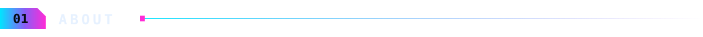

I'm a B.Tech (CSE, 2024) graduate from Bhubaneswar who builds AI systems that are **fast, measurable, and trustworthy**.
At **Infosys** (PM Internship Scheme) I built a multi-agent research platform and cut its report time by **54%**.
I like taking messy, slow, or unreliable AI output and making it something a team can depend on.

```text
status    : open to AI Engineer / Software Engineer roles
focus     : multi-agent systems, LLM evaluation, Python backends
based in  : Bhubaneswar, Odisha, India
```

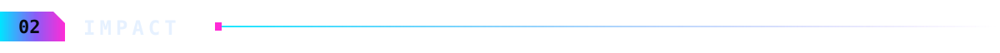

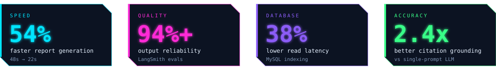

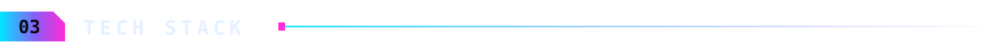

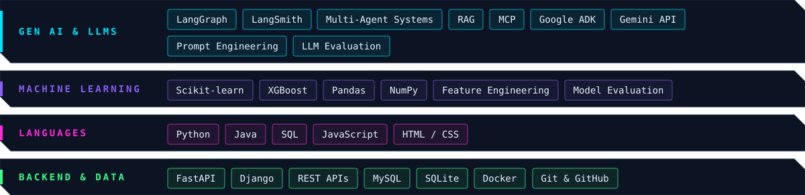


<a href="https://huggingface.co/spaces/Bikashkumarnaik/autonomous-cognitive-engine"></a>

<a href="https://oasis-secure-reporting.streamlit.app/"></a>

<a href="https://github.com/bikash-kumar-dev/Datasage"></a>

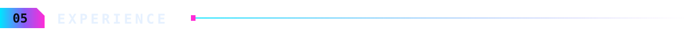



| | |
|---|---|
| **AI Agents Intensive Course** · Google & Kaggle | **Building and Deploying Intelligent Agents with Google ADK** · Infosys |
| **Demystifying Agentic AI** · Infosys | **Deep Learning for Developers** · Infosys |
| **Machine Learning Training** · Internshala | **Software Programmer, Python (Gold)** · NASSCOM FutureSkills Prime |

